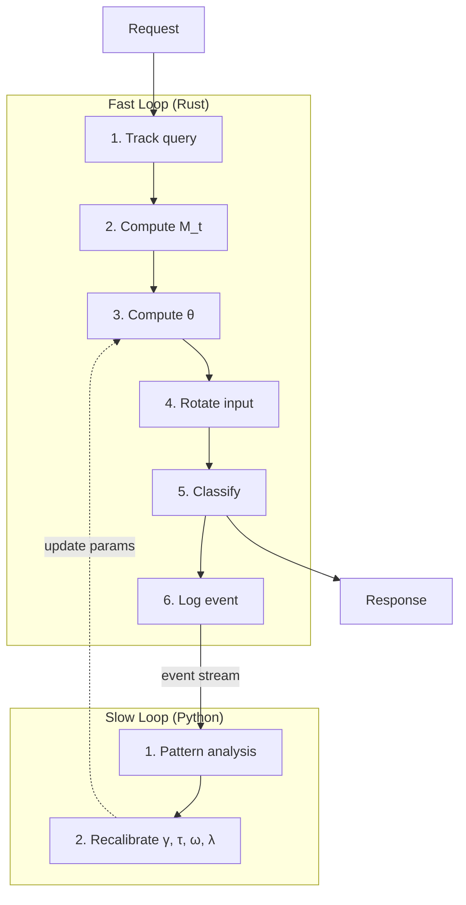
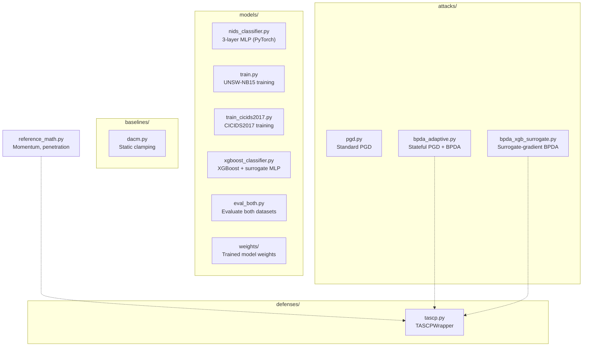

# Architecture

## Two-Loop Design

TASCP uses a two-loop architecture:

- **Fast loop** (Rust, `tascp-proto/fast-loop/`): in-memory sliding-window
  history, per-request Givens rotation, synchronous, <1ms target.
- **Slow loop** (Python, `tascp-proto/slow-loop/`): async event-log analysis,
  recalibrates defense parameters, no latency constraint.

## Evaluation Framework

## Defense Components (TASCPWrapper)

1. **Momentum tracking** — cosine similarity `M_t` between consecutive
   velocity vectors `v_t` and `v_{t-1}`.
2. **Penetration** — windowed average `eps_p = mean(||v_i|| * max(0, M_i))`.
3. **Rotation angle** — `delta_theta = gamma * clamp(eps_p - tau, 0)`.
4. **Givens rotation** — rotates in the span of `{u, v_t_perp}` where `u`
   is the normalized current velocity and `v_t_perp` is the orthogonal
   component of the previous velocity.

## Attack Components

1. **PGD** — standard multi-step projected gradient descent with L2/Linf
   norms and optional momentum (MIM).
2. **BPDA (stateful)** — PGD that interfaces with TASCPWrapper's history;
   supports adaptive=False (detached rotation) and adaptive=True (full
   gradient flow through rotation).
3. **Surrogate-gradient BPDA** — for non-differentiable targets: gradients
   from a surrogate MLP, success evaluation against the real model.

## Config System

Hydra YAML configs in `configs/`:
- `attack/pgd.yaml` — epsilon, alpha, iterations, norm
- `dataset/unsw_nb15.yaml`, `dataset/cicids2017.yaml`
- `base.yaml` — shared defaults
